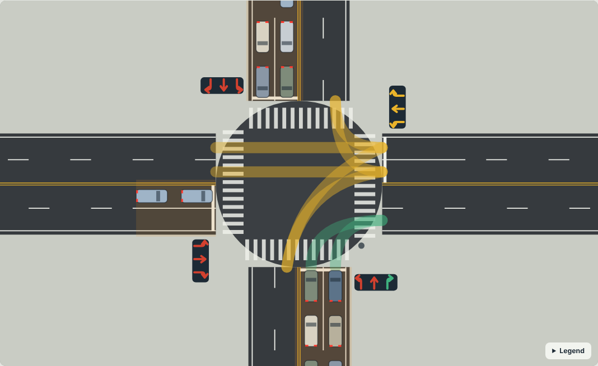
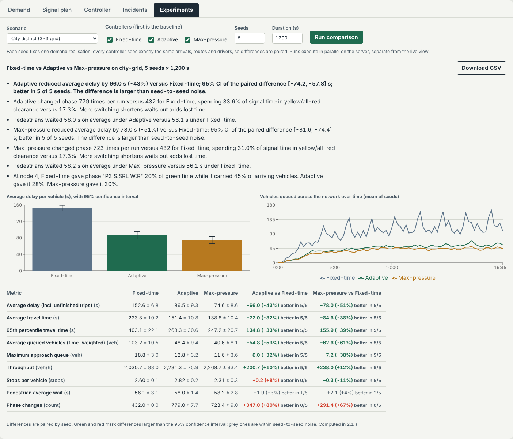

# Smart Traffic Simulator

An interactive traffic-signal laboratory: a deterministic **C++20 simulation engine**
modelling vehicles, lanes, signals and pedestrians on an urban road network; a
**REST + WebSocket server** that streams it live; and a **React/Canvas** interface where you
change demand, edit signal plans, cause incidents, switch controllers, and run fair,
repeatable experiments that explain *why* one strategy beats another.



## What it does

- **Vehicles** follow the Intelligent Driver Model (cars, buses, emergency vehicles),
  choose lanes by turn, change lanes only when gaps are safe, route with Dijkstra, and
  reroute around closures.
- **Signals** are driven by an explicit conflict model. Phases are generated by graph
  colouring (or given explicitly) and validated so that conflicting movements can never be
  green together; a safety layer enforces minimum green, yellow, all-red and pedestrian
  clearance whatever a controller asks for.
- **Pedestrians** arrive at crosswalks, wait for WALK, and cross at their own speed;
  vehicles never enter an occupied crossing.
- **Three controllers** share one interface: fixed-time (the baseline), a transparent
  adaptive heuristic (queue/wait scoring, gap-out, hysteresis, starvation guard, emergency
  priority) and max-pressure.
- **Experiments** run each controller against the *same demand realisation* over many
  seeds in parallel, report means with 95% confidence intervals, paired differences, and
  data-driven explanations. Results export to CSV.
- **Determinism**: the same scenario, seed and command log reproduce a run bit-for-bit;
  the server can seek to any time by replay.

## Results (measured, 10 seeds, 900–1500 s per run)

Average delay per vehicle, including trips still under way (lower is better). "sig." means
the paired 95% confidence interval of the difference excludes zero.

| Scenario | Fixed-time (s) | Adaptive (s) | Max-pressure (s) | Adaptive vs fixed | Max-pressure vs fixed |
| --- | --- | --- | --- | --- | --- |
| light-traffic | 40.2 ± 2.9 | 14.3 ± 1.9 | 13.4 ± 1.8 | −64% (sig.), 10/10 seeds | −67% (sig.), 10/10 |
| single-intersection | 50.7 ± 2.0 | 36.8 ± 6.0 | 32.6 ± 6.5 | −27% (sig.), 9/10 | −36% (sig.), 9/10 |
| uneven-demand | 157.4 ± 14.0 | 64.8 ± 12.9 | 58.3 ± 10.6 | −59% (sig.), 10/10 | −63% (sig.), 10/10 |
| pedestrian-heavy | 43.5 ± 2.1 | 26.6 ± 2.1 | 23.2 ± 2.2 | −39% (sig.), 10/10 | −47% (sig.), 10/10 |
| city-grid (3×3) | 161.1 ± 5.5 | 90.9 ± 5.9 | 75.8 ± 5.0 | −44% (sig.), 10/10 | −53% (sig.), 10/10 |
| rush-hour | 60.6 ± 4.0 | 66.8 ± 7.0 | 58.0 ± 7.2 | **+10% (not sig.)**, 3/10 | −4% (not sig.), 5/10 |
| wide-arterial | 61.4 ± 4.1 | 59.2 ± 2.7 | 65.1 ± 4.3 | −3% (not sig.), 8/10 | +6% (not sig.), 2/10 |



Demand-responsive control helps most where fixed greens are wasted (light or lopsided
demand, grids). Near saturation every phase has a queue, so skipping phases gains
little while extra switching costs yellow/all-red time — the adaptive heuristic is not
better than a well-timed fixed plan there. Reproduce any row with
`./build/release/traffic_cli compare config/scenarios/<id>.json --seeds 10`.

## Quick start

Requirements: a C++20 compiler (GCC 12+ or Clang 16+), CMake 3.20+, Node 20+.
Dependencies are found on the system or downloaded automatically (FetchContent):
nlohmann/json, standalone Asio, spdlog, GoogleTest, Google Benchmark.

```bash
# Ubuntu/Debian: system packages make the configure step offline and fast
sudo apt-get install cmake nlohmann-json3-dev libasio-dev libspdlog-dev libgtest-dev libbenchmark-dev

cmake --preset release
cmake --build --preset release -j
ctest --preset release            # 124 tests

cd frontend && npm ci && npm run build && cd ..
./build/release/traffic_server    # http://localhost:8080
```

For UI development with hot reload run `scripts/dev.sh` (server on :8080, Vite on :5173).

With Docker: `docker compose up --build`, then open http://localhost:8080.
(The image could not be built inside the sandbox this project was developed in because
Docker Hub was unreachable there; CI builds it and smoke-tests the container.)

### Headless

```bash
./build/release/traffic_cli validate config/scenarios/city-grid.json
./build/release/traffic_cli run config/scenarios/rush-hour.json --controller adaptive --seed 3
./build/release/traffic_cli compare config/scenarios/uneven-demand.json --seeds 10 --csv results.csv
python3 scripts/analyze_experiment.py results.csv --plot delay.png
```

### Other builds

```bash
cmake --preset debug && cmake --build --preset debug && ctest --preset debug
cmake --preset asan  && cmake --build --preset asan  && ctest --preset asan    # AddressSanitizer + UBSan
cmake --preset tsan  && cmake --build --preset tsan  && ctest --preset tsan    # ThreadSanitizer
./build/release/benchmarks/traffic_benchmarks --benchmark_counters_tabular=true
```

Sanitizer presets assume GCC or Clang on Linux/macOS; MSVC builds ignore them.

## Using the lab

1. Pick a scenario in the top bar and press **Run**. Drag to pan, scroll to zoom,
   double-click to fit, arrow keys and `+`/`−` work when the map has focus.
2. **Demand**: scale vehicle and pedestrian demand, disable buses or emergency vehicles,
   dispatch an emergency vehicle between two edge nodes.
3. **Signal plan**: edit fixed-time greens and min/max green per phase. The server
   validates every value.
4. **Controller**: switch between fixed-time, adaptive and max-pressure and tune the
   adaptive weights. The right rail shows each controller's latest reason for switching.
5. **Incidents**: click a road to close it (traffic reroutes), block a lane (vehicles
   merge around it) or change its speed limit.
6. **Experiments**: compare controllers over several seeds; read the findings, inspect
   the confidence intervals, download CSV.

## Repository layout

```text
include/traffic/   engine headers (core, network, vehicles, signals, pedestrians,
                   controllers, metrics, experiments, infrastructure)
src/               engine, infrastructure (JSON, coordinator), api (HTTP/WS server), cli
tests/             unit, integration (simulation, coordinator, server), simulation (invariants)
benchmarks/        Google Benchmark suites
config/            server config and scenario library
frontend/          React + TypeScript + Vite + Canvas UI
scripts/           dev runner, experiment CSV analysis
docs/              architecture, system design, model, algorithms, API, concurrency,
                   performance, ADRs, implementation plan and progress
```

## Documentation

| Document | Contents |
| --- | --- |
| [architecture.md](docs/architecture.md) | Components, dependency rules, diagrams |
| [system-design.md](docs/system-design.md) | Requirements, threading, backpressure, failure handling, scaling |
| [simulation-model.md](docs/simulation-model.md) | Coordinates, road graph, IDM, junctions, pedestrians, update order, metrics, limitations |
| [algorithms.md](docs/algorithms.md) | Routing, phase generation, controllers, complexity |
| [api-specification.md](docs/api-specification.md) | REST endpoints and WebSocket protocol v1 |
| [concurrency.md](docs/concurrency.md) | Thread ownership, queue guarantees, snapshot immutability |
| [performance.md](docs/performance.md) | Benchmark method, measured results, profiling, optimisations |
| [adr/](docs/adr/) | Architecture decision records |

## Known limitations

- Right-hand traffic only; no unsignalised priority junctions with three or more arms
  (rejected at load time); no roundabouts.
- Vehicles from the same approach do not interact inside the junction box, and other
  drivers do not yield to emergency vehicles (only the adaptive controller prioritises
  them).
- The pedestrian model is a behavioural proxy for waiting and signal compatibility, not a
  pedestrian-safety analysis tool. Fuel and emissions are not modelled.
- The single simulation thread handles roughly 10,000 vehicles at ~50× real time on one
  core of the development machine; very large networks also need a lower snapshot rate.
