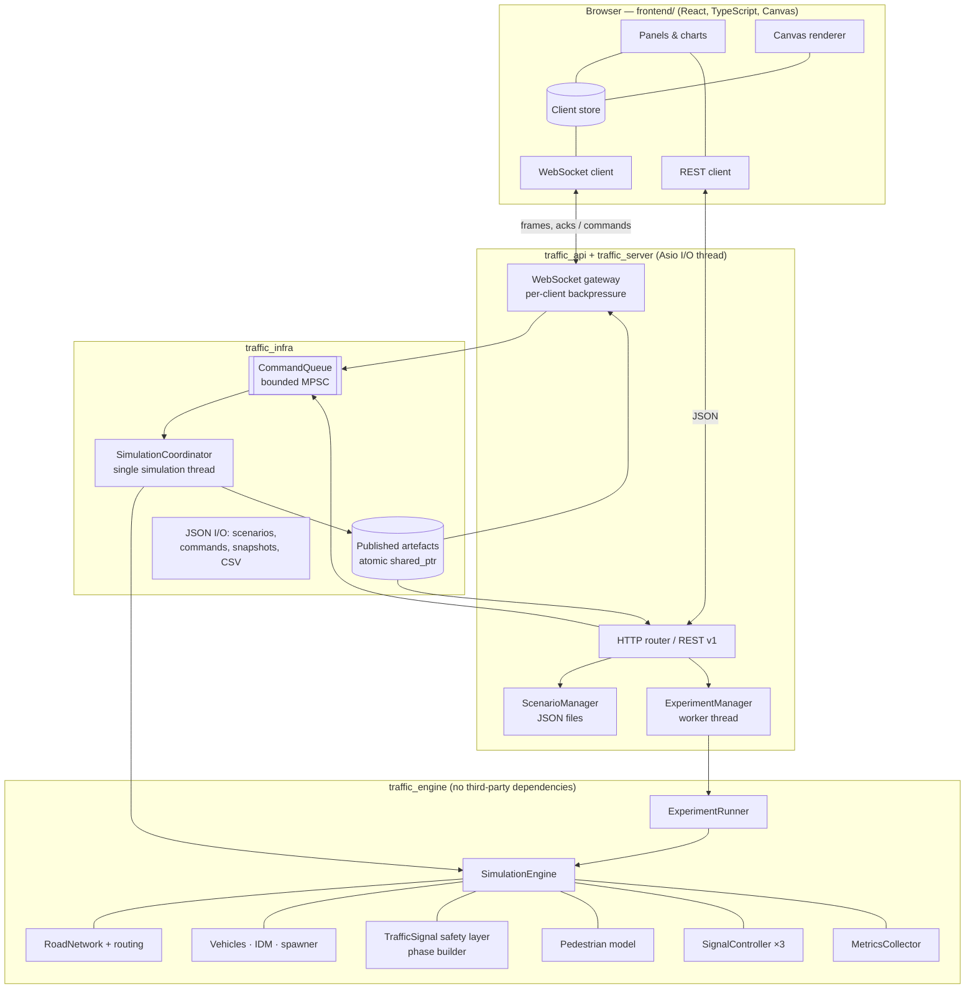
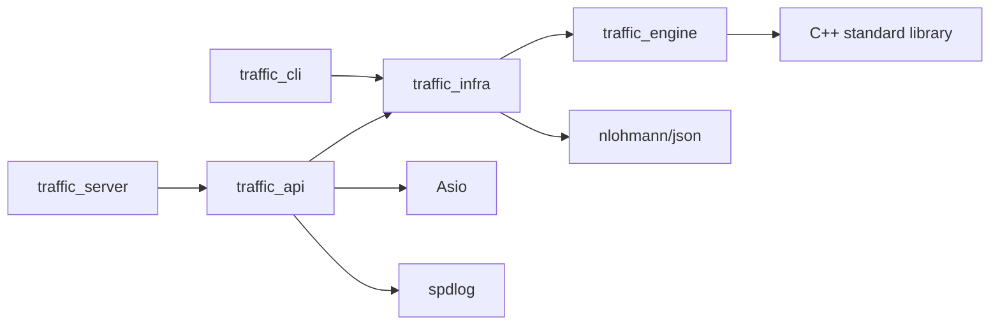
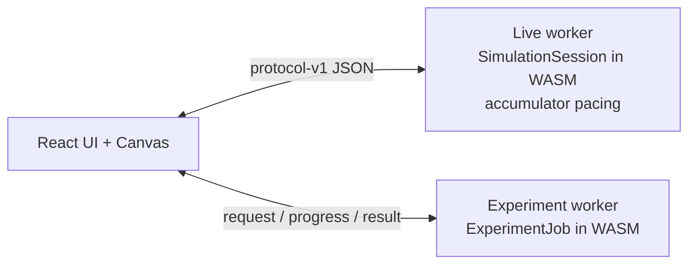
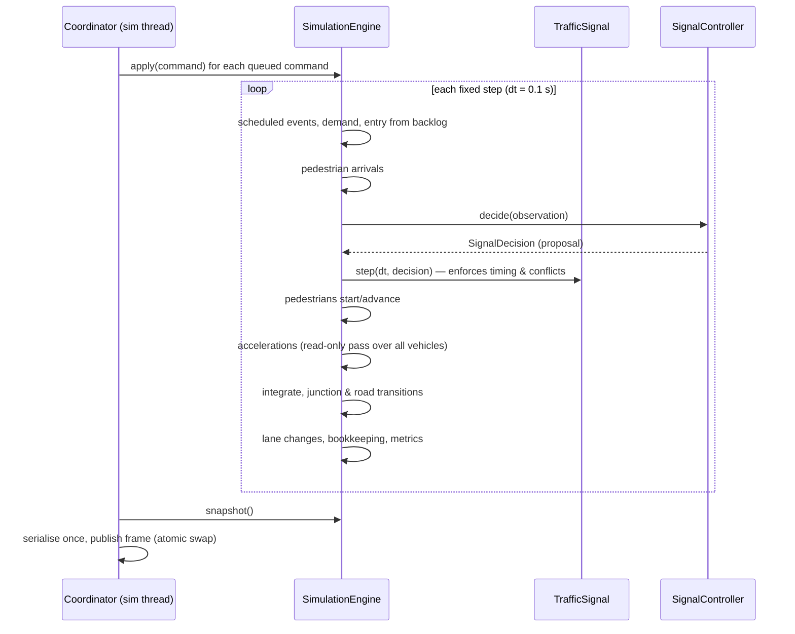
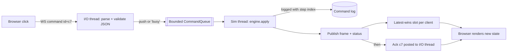

# Architecture

The system is a modular monolith: one server process with clearly separated libraries,
plus a browser application. The diagram below shows logical responsibilities and the
build targets that implement them.

## Components

| Component | Responsibility | Owns |
| --- | --- | --- |
| `SimulationEngine` | Advances the world by one fixed step; validates and applies commands; produces snapshots, metrics and a state hash | All mutable world state |
| `RoadNetwork` | Directed graph of nodes and roads; lanes, movements, connector curves, crosswalks; validation | Geometry and topology (runtime closure/blockage flags) |
| `VehicleSpawner` | Seeded demand realisation (arrivals, destinations, classes, driver parameters) | Two RNG streams |
| `TrafficSignal` | Safety-enforcing signal state machine (min green, yellow, all-red, pedestrian intervals, conflict-free greens) | Phase timing state |
| `SignalController` | Policy: fixed-time, adaptive, max-pressure. Sees only `IntersectionObservation` | Controller-private state |
| `PedestrianModel` | Arrivals, waiting, crossing, crosswalk occupancy | Pedestrians |
| `MetricsCollector` | Trip, queue, pedestrian and time-series metrics | Accumulators |
| `ExperimentRunner` | Paired multi-seed runs on a worker pool; statistics and explanations | Nothing shared |
| `SimulationCoordinator` | The simulation thread: drains commands, paces fixed steps, publishes immutable frames | The live engine |
| `Server` (api) | HTTP/1.1 + RFC 6455, routing, per-client queues, static files | Sessions (I/O thread only) |
| `ScenarioManager` / `ExperimentManager` | Scenario library on disk; queued experiments with bounded retention | Their maps, under mutexes |

## Dependency rules

1. The engine never depends on HTTP, WebSocket, JSON, files, logging or wall-clock time,
   so it runs identically inside tests, the CLI, experiment workers and the server.
2. The frontend never computes vehicle physics or signal state; it renders snapshots
   (interpolating positions for display only) and sends validated commands.
3. Only the simulation coordinator advances live simulation time. Experiments build their
   own isolated engines.
4. Networking threads never touch engine objects. They enqueue commands and read immutable
   published artefacts.
5. Scenario configuration (`ScenarioConfig`, immutable) is separate from runtime state
   (`SimulationEngine`). Reset rebuilds the engine from the configuration.

## Browser (static) runtime

For free static hosting the same engine is compiled to WebAssembly with Emscripten
(`scripts/build_wasm.sh`, bindings in `src/wasm/wasm_bindings.cpp`). In that build:

- `SimulationSession` (load, reset, seek, commands, settings that survive reset, JSON
  serialisation) is shared by the native `SimulationCoordinator` thread and the browser
  live worker, so behaviour can't drift between the two.
- The live worker reproduces the coordinator's pacing and ordering rules (fixed steps,
  250 ms catch-up cap, 20 Hz snapshots, publish-before-acknowledge) and emits the same
  messages as the WebSocket gateway; the UI swaps `SimSocket` for `LocalEngineTransport`.
- Experiments run one run at a time in a second worker (no threads in this build), so the
  live view never stalls; results are identical to native runs.
- The server build never downloads the WebAssembly module (it's a lazily loaded chunk).

## Key design decisions

| Decision | Why | Alternatives rejected |
| --- | --- | --- |
| Single authoritative simulation thread | Entities interact through shared lanes and junctions; one writer makes determinism and reasoning simple. Profiling shows one core handles ~10k vehicles at ~50× real time | Parallel entity updates (needs partitioning and synchronisation for little benefit at this scale) — [ADR 0002](adr/0002-single-simulation-thread.md) |
| Fixed timestep (0.1 s) with accumulator pacing | Physical results independent of frame rate, network or speed setting | Variable dt (non-deterministic, unstable) |
| Controllers propose, signals enforce | A buggy or adversarial controller can't create conflicting greens | Trusting each controller — [ADR 0003](adr/0003-signal-safety-layer.md) |
| Explicit conflict model from connector geometry | Phase plans (generated or user-supplied) can be validated mechanically | Hard-coded 4-way templates |
| Immutable snapshots via `atomic<shared_ptr<const T>>` | Readers never block the simulation thread and can hold old frames safely | Double buffering with locks |
| Latest-wins telemetry, bounded control channel | Slow clients get fresh state with bounded memory; commands are never dropped silently | Unbounded per-client queues — [ADR 0004](adr/0004-backpressure.md) |
| Hand-written HTTP/WebSocket on standalone Asio | Small, auditable surface; one dependency already required for async I/O | Boost.Beast (heavier dependency), a separate web framework |
| Same engine compiled to WebAssembly for static hosting | Free hosting without a server; reuses the exact C++ code and protocol | Rewriting the engine in TypeScript (two implementations), or a paid always-on server |
| Separate seeded RNG streams | Demand realisation is identical across controllers, enabling paired comparisons | One global RNG — [ADR 0005](adr/0005-paired-experiments.md) |

## Simulation step sequence

## Command-to-snapshot data flow

The acknowledgement is sent only after the frame reflecting the command is published,
so a client that has seen the ack never reads stale state.
