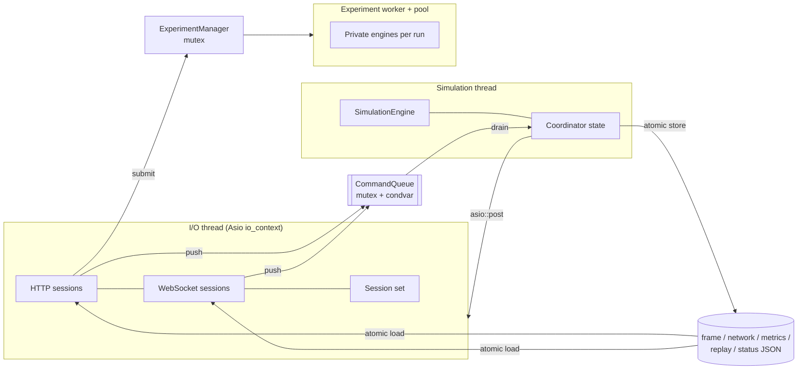

# Concurrency

## Thread ownership

| State | Owner | Other threads may |
| --- | --- | --- |
| `SimulationEngine` and everything in it | simulation thread | nothing (no references escape) |
| Coordinator settings, accumulator, speed | simulation thread | read the published `CoordinatorStatus` copy (mutex) |
| Published artefacts | simulation thread writes | load the `shared_ptr` atomically and read the immutable object for as long as they hold it |
| HTTP/WS sessions, session set, server counters | I/O thread | nothing; other threads `asio::post` work onto the I/O thread |
| Scenario library | `ScenarioManager` mutex | read/write through its methods |
| Experiment jobs | `ExperimentManager` mutex (progress counter is atomic) | read views through its methods |
| Engines used by experiments | the worker running that job | nothing; each run writes only its own result slot |

No thread ever holds two of these locks at once, so lock ordering issues cannot arise.

## Command queue

`CommandQueue<T>` (include/traffic/infrastructure/command_queue.hpp):

- **Thread-safe** multi-producer, single-consumer: producers (`push`) are the I/O thread
  and anything else holding the coordinator; the consumer (`drain`) is the simulation
  thread.
- **FIFO** in the order `push` calls take the mutex; per-producer order is preserved
  (tested with four concurrent producers).
- **Bounded and non-blocking**: when full, `push` returns `false` without enqueueing; the
  caller reports `busy` (HTTP 503 / WS `error`). Commands are never dropped silently.
- **Wake-up**: `push` notifies a condition variable the simulation thread waits on with a
  deadline (next frame or metrics publication), so commands are handled promptly without
  busy-waiting.

Each command carries a completion callback. The simulation thread applies all commands in
a batch, publishes the resulting frame/status, then runs the callbacks, which only
`asio::post` the reply to the I/O thread.

## Snapshot immutability

A frame is built on the simulation thread as a `SimulationSnapshot` value, serialised to a
string once, wrapped in `shared_ptr<const PublishedFrame>`, and published with
`std::atomic<std::shared_ptr<...>>::store`. After that:

- the object is never modified (it's `const`);
- readers (`latest_frame()`, REST handlers, WebSocket sessions) take a `shared_ptr` copy,
  so the frame stays alive as long as any reader holds it, even after newer frames replace
  it;
- the WebSocket writer passes the shared string straight to `async_write` (no copy per
  client) and keeps the pointer alive in the completion handler.

## Race prevention

- The engine has exactly one writer. Experiments never share an engine; results are
  written to pre-sized slots by index, so the output order is independent of scheduling
  and identical for 1 or N threads (tested by comparing final state hashes).
- Sessions are only touched on the I/O thread. Broadcasts from the simulation thread are
  `asio::post`ed closures capturing `shared_ptr`s, never raw references to session state.
- Command replies capture a `weak_ptr` to the session, so a reply for a client that has
  disconnected is simply discarded.
- Shutdown order: stop the simulation thread (no more posts), then stop the server (close
  sessions, join the I/O thread); experiment workers are cancelled and joined by the
  manager's destructor.

All 124 tests pass under **ThreadSanitizer** (`cmake --preset tsan`, `halt_on_error=1`),
including the server tests that drive the coordinator, broadcasts and slow clients
concurrently.

## Backpressure behaviour

| Channel | Policy | Bound |
| --- | --- | --- |
| Client → simulation (commands) | reject when full | `command_queue_capacity` (256) |
| Simulation → client (snapshots, status) | latest-wins replacement | 1 in flight + 1 pending per client |
| Simulation → client (acks, errors, network) | FIFO, disconnect on overflow (1008) | `ws_control_queue_limit` (256) |
| Kernel socket buffer | capped so stale frames don't accumulate below user space | `ws_send_buffer_bytes` (128 KB) |
| Simulation vs. wall clock | run slower than requested rather than spiral | ≤ 250 ms of catch-up per wake-up; `lagging` flag |
| Experiments | reject when too many queued | 5 pending; 20 retained results |
